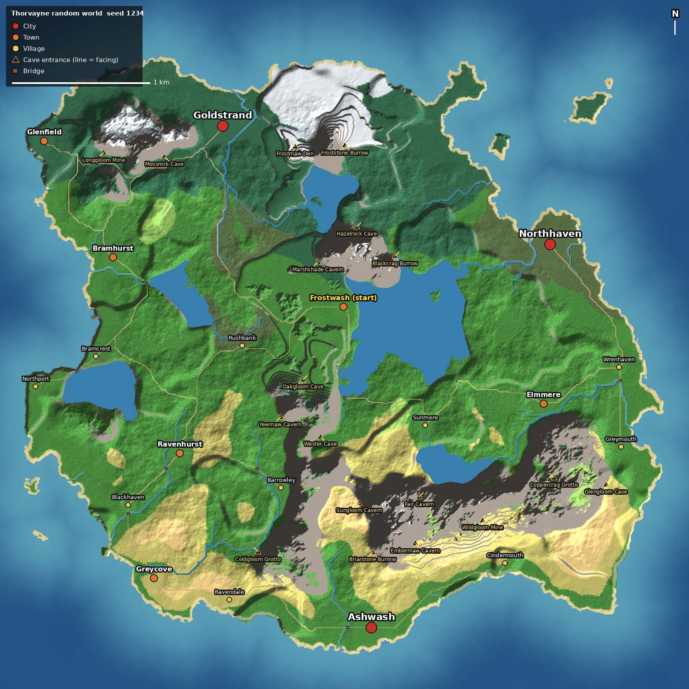

# Thorvayne

Stylized MMO RPG (Unity, URP). This repository holds the world tools and test character.

## The map
The official world is the **random 5 x 5 km world, seed 1234**.
- In Unity: **Thorvayne > Random World Generator**, seed `1234`, **Generate world**, then save the scene
  (e.g. `Thorvayne_Main`). Don't regenerate in that scene; edit it by hand from there.
- Reference snapshot of that world (place list, heightmap, map picture and a frozen copy of the generator):
  `Docs/seed1234_final/`.
- Changing `ThorvayneWorldGen.cs` changes what seed 1234 produces. Keep seed 1234's output the same, or work in
  the saved scene instead.

## Opening in Unity
The repository root is a Unity project for **Unity 6000.6.6f1** (Unity Hub: Add > Add project from disk,
pick this folder). On first open Unity creates the rest of the project files. To use URP like the rest of the
project, install **Universal RP** from Window > Package Manager > Unity Registry (the tools work with or without it).

## Folders
- `Assets/Thorvayne/` — drop into a Unity project's `Assets` folder (Unity 6 or 2022.3).
  - `Editor/RandomWorld/` — the 5 x 5 km generator, its window, and the Test Player setup.
  - `Editor/ThorvayneWorldBuilder.cs` + `MapData/` + `Tools/` — the earlier world built from the hand-drawn map
    (**Thorvayne > Build World From Map**).
  - `Scripts/` — test player controller, character animator, skills, inventory, woodcutting, game UI, `WorldMarker` tags.
  - `Trees/` — real tree models that replace the placeholders (the broadleaf so far).
  - `Characters/ThorvayneHero.fbx` — Mixamo-rigged hero (Humanoid) with Idle/Walk/Run/Jump/Swim/Fly/Chop.
  - `README_RandomWorld.md` / `README.md` — how to use each tool.
- `Extras/` — Blender source for the hero and the scripts used to build it (keep out of `Assets`).
- `Docs/` — previews and the seed 1234 snapshot.
- `Tools/WorldPreview/` — offline preview renderer for the generator (mono + Python), used for the map images.

## Controls (Test Player)
WASD move · mouse look · X walk/run · Shift sprint · Space jump · wheel zoom · F fly · T next town/cave · R spawn · Esc free mouse.
E chop tree · I or Tab inventory · G equipment · K skills.
